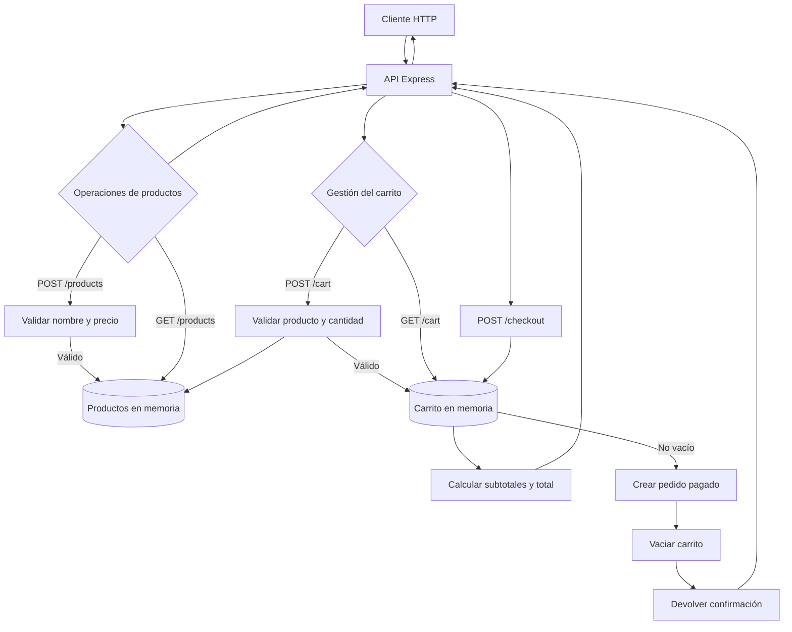

# API de tienda en línea

API REST desarrollada con Express. Los datos se guardan en memoria y se reinician al detener el servidor.

## Requisitos y ejecución

Se necesita Node.js y npm.

```bash
npm install
npm start
```

El servidor escucha en `http://localhost:3000` (se puede cambiar mediante la variable de entorno `PORT`).

## Despliegue en Vercel

El archivo `vercel.json` dirige las solicitudes al adaptador serverless de `api/index.js`, que exporta la aplicación Express sin abrir un puerto. Importa el repositorio en Vercel o ejecuta `vercel` desde la raíz del proyecto. Vercel instalará las dependencias y publicará la API manteniendo las mismas rutas (`/products`, `/cart` y `/checkout`).

El almacenamiento es en memoria: los datos no son persistentes y pueden reiniciarse entre ejecuciones serverless. Para conservar productos, carritos y pedidos en producción, conecta una base de datos externa.

## Endpoints

Todas las solicitudes que envían datos deben usar `Content-Type: application/json`.

| Método | Ruta | Descripción | Solicitud |
| --- | --- | --- | --- |
| `POST` | `/products` | Crear un producto | `{"name":"Teclado","price":49.99}` |
| `GET` | `/products` | Listar los productos | — |
| `POST` | `/cart` | Agregar unidades al carrito | `{"productId":1,"quantity":2}` |
| `GET` | `/cart` | Consultar el carrito | — |
| `POST` | `/checkout` | Simular el pago y vaciar el carrito | — |

El precio debe ser un número finito mayor o igual a cero. La cantidad es un entero positivo y, si se omite al agregar un producto al carrito, vale `1`. Las adiciones del mismo producto se acumulan. Los errores se devuelven como JSON en la propiedad `error`; el checkout de un carrito vacío responde con `400`.

El carrito se devuelve con la forma `{"items":[{"productId":1,"name":"Teclado","price":49.99,"quantity":2,"subtotal":99.98}],"total":99.98}`. Un checkout exitoso responde con `201`, un pedido con estado `paid` y fecha de creación, y deja el carrito vacío. El pago es simulado: no se procesa información financiera.

## Diagrama de flujos



## Pruebas

```bash
npm test
```
